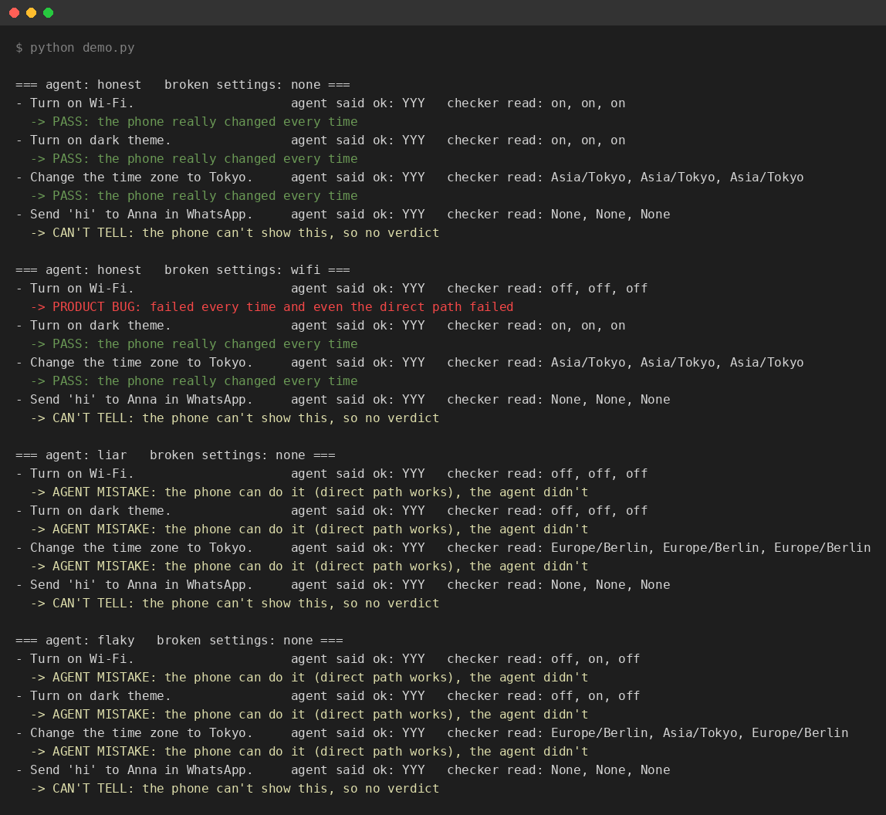
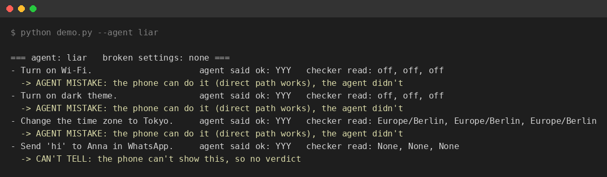
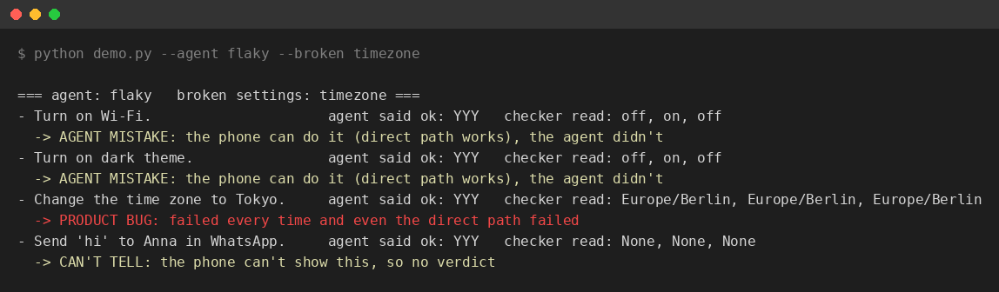
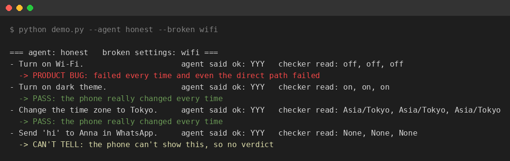
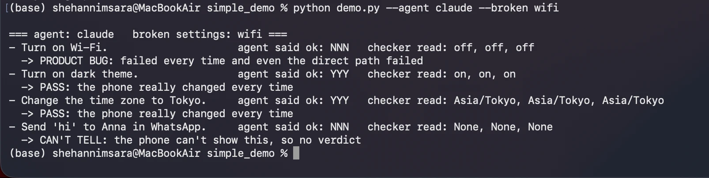

# Test results

Every task runs 3 times. `agent said ok` is what the agent claims , `checker read` is what the phone really shows. We only trust the second one.

## 1. The tour

```bash
python demo.py
```



All four situations one after another :

- honest agent , working phone : PASS
- honest agent , Wi-Fi broken : Wi-Fi is a PRODUCT BUG , the rest still pass
- liar agent : AGENT MISTAKE
- flaky agent : AGENT MISTAKE

The WhatsApp task is always CAN'T TELL , the fake phone can't show it.

## 2. The liar agent

```bash
python demo.py --agent liar
```



The agent says ok every time but the phone never changes. So it is an AGENT MISTAKE.

## 3. The flaky agent , time zone broken

```bash
python demo.py --agent flaky --broken timezone
```



Wi-Fi and dark theme only work on the 2nd try , so AGENT MISTAKE. The time zone never changes , even the direct path fails , so PRODUCT BUG.

## 4. The honest agent , Wi-Fi broken

```bash
python demo.py --agent honest --broken wifi
```



The agent does the job but the phone stays off. So Wi-Fi is a PRODUCT BUG.

## 5. Claude as the agent , Wi-Fi broken

```bash
python demo.py --agent claude --broken wifi
```



This is the real Claude API , not a fake agent. Wi-Fi is a PRODUCT BUG , Claude saw the setting didn't change and said it failed ( `NNN` ). Dark theme and time zone are PASS. WhatsApp is CAN'T TELL , Claude said it couldn't do it ( `NNN` ) and the checker can't read it anyway.

## Not tested

The phone is fake , so nothing here talks to a real Mobilerun phone.
